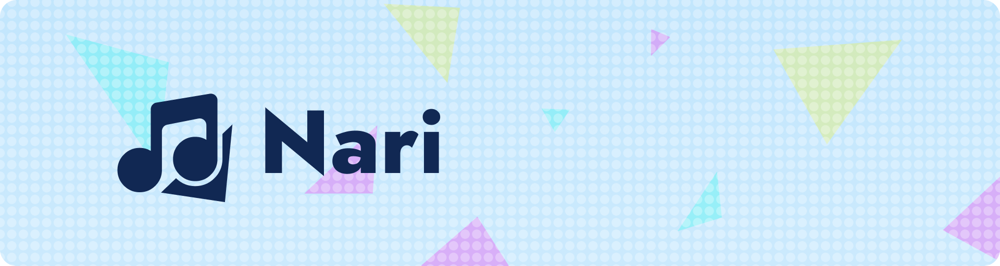
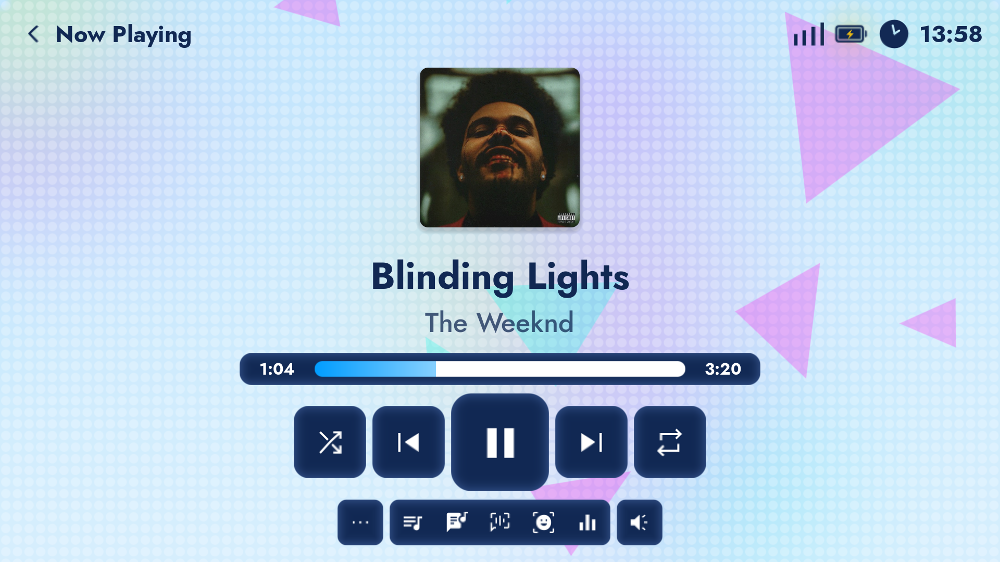
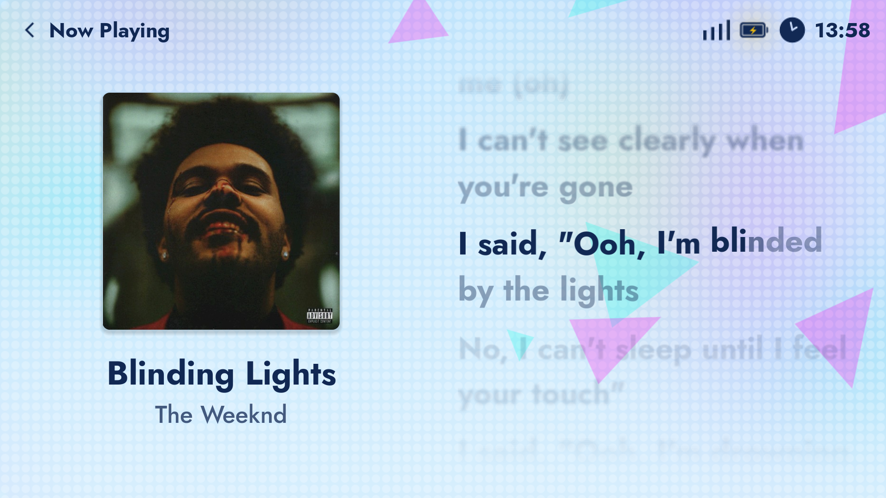
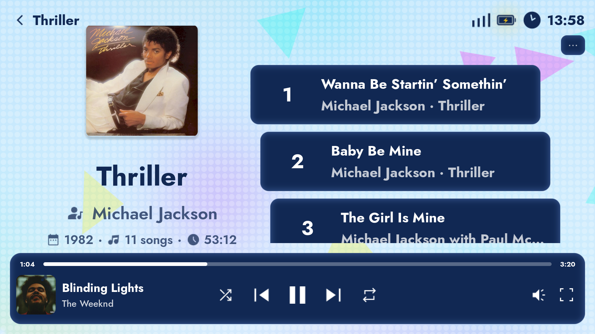
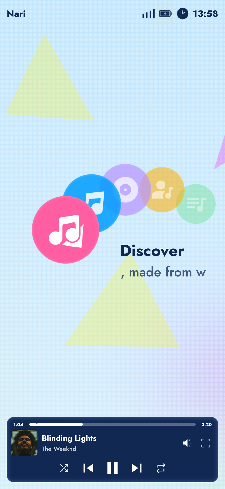
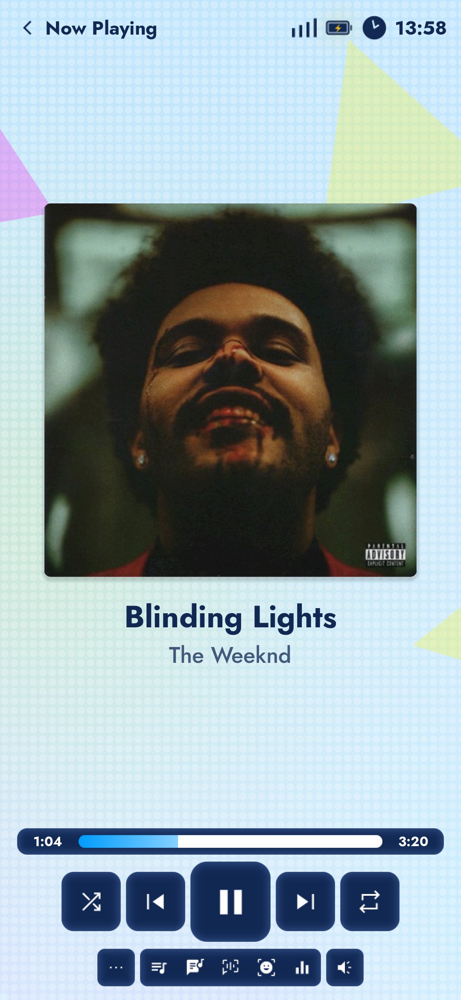
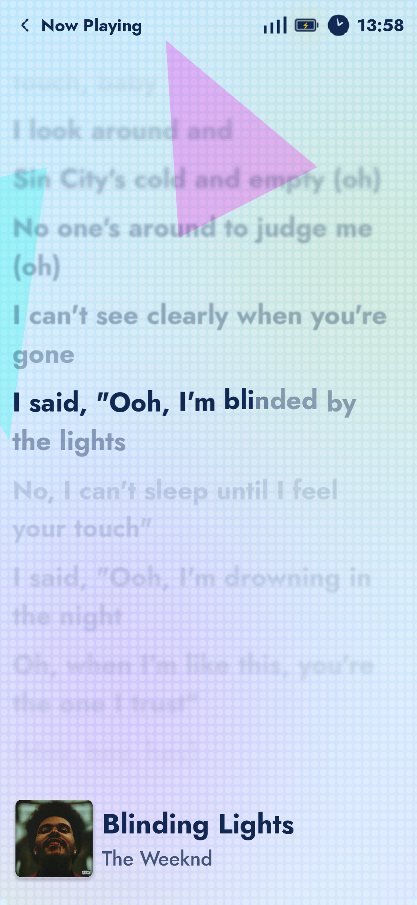
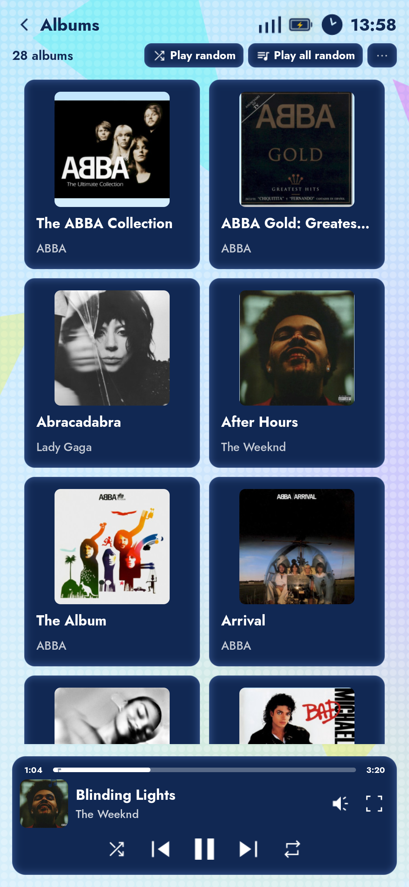
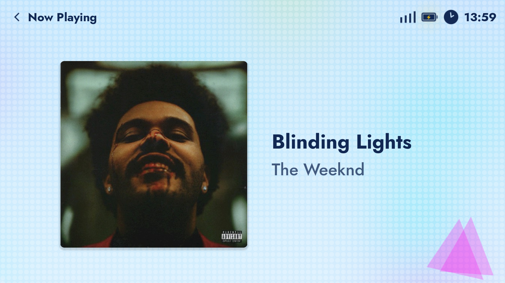
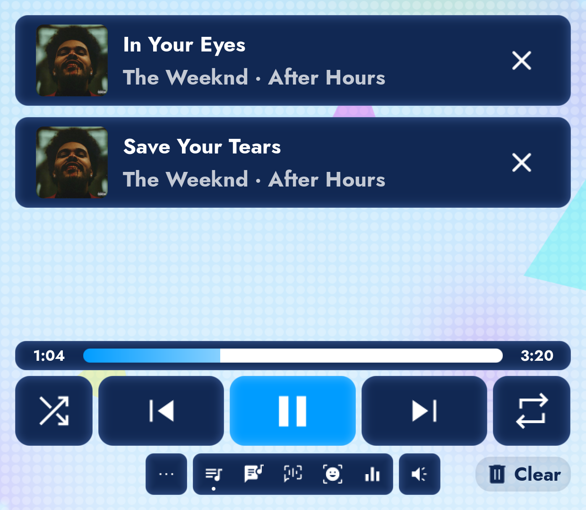

<p align="center">
  <a href="https://narimusic.com"></a>
</p>

<p align="center">A beautiful music player with a retro console experience in mind.</p>

<p align="center">
  <a href="https://github.com/NaviVani-dev/Nari/releases/latest"></a>
  <a href="LICENSE"></a>
  <a href="https://discord.gg/PUWxS5Yyj9"></a>
  <a href="https://ko-fi.com/navivani_dev"></a>
</p>

<p align="center">
  <a href="https://narimusic.com">Website</a>
  ·
  <a href="https://narimusic.com/themes/">Themes</a>
  ·
  <a href="https://narimusic.com/plugins/">Plugins</a>
  ·
  <a href="https://narimusic.com/docs/">Docs</a>
  ·
  <a href="https://narimusic.com/privacy/">Privacy</a>
</p>

<div align="center">
  <table>
    <tr>
      <td colspan="2"></td>
    </tr>
    <tr>
      <td width="50%"></td>
      <td width="50%"></td>
    </tr>
  </table>
  <table>
    <tr>
      <td width="25%"></td>
      <td width="25%"></td>
      <td width="25%"></td>
      <td width="25%"></td>
    </tr>
  </table>
  <table>
    <tr>
      <td align="center">
        <br>
        
      </td>
    </tr>
  </table>
  <sub>On a PC, a phone and both screens of the AYN Thor.</sub>
</div>

## Features

- **Your music:** Use local files or custom providers for music.
- **Synced lyrics** from many providers, with karaoke highlighting and romanization
- **Made for handhelds:** full gamepad support for the best console experience
- **Dual screens:** For dual-screen handheld devices, or just multi monitors
- **Themes** that change colors, fonts, icons and animated backgrounds, with a [theme editor](https://narimusic.com/theme-editor/)
- **Plugins** in Lua that add music sources, lyrics, visualizers and more
- **Sound effects:** speed and pitch, 8-bit, radio, gramophone, acapella and more, everything live.
- **Soundboard** to play your own sounds over the music
- **Visualizers** to see your music in fancy ways
- **Chromecast support** to available devices.
- **Offline downloads** for available music sources.
- **Gapless playback** and volume normalization
- **Tracker and MIDI files**, with your own SoundFonts
- **Scrobbling** to Last.fm and ListenBrainz
- **Discord Rich Presence**, media controls and the system tray

## Download

### [Get the latest release](https://github.com/NaviVani-dev/Nari/releases/latest)

Builds for Android, Linux (x64 and arm64), Windows and macOS are on the releases page.

Themes and plugins are installed from Nari itself, or from [narimusic.com](https://narimusic.com).

## Community

Come hang out, share your themes and plugins, and help shape Nari on [Discord](https://discord.gg/PUWxS5Yyj9)!

Found a bug or have an idea? [Open an issue](https://github.com/NaviVani-dev/Nari/issues).

Want to make your own theme or plugin? The [docs](https://narimusic.com/docs/) cover everything, and the
[theme editor](https://narimusic.com/theme-editor/) makes a theme without writing anything.

## Building

Nari is made with [Godot 4.7](https://godotengine.org). The native libraries are already built in `addons/*/bin/`,
so opening the project in Godot is enough to run it.

Android exports use a Gradle build, so set up the Android SDK and JDK in Godot first. Godot's
[Exporting for Android](https://docs.godotengine.org/en/stable/tutorials/export/exporting_for_android.html) guide walks you through it.

Everything else runs with [just](https://github.com/casey/just) and Python 3:

```bash
just build                # every platform, plus the plugins and store metadata
just build linux android  # only those
just build aab            # signed App Bundle for Google Play
just test                 # the native library's tests
just take-screenshots
just generate-metadata
```

Godot, the Android SDK and the JDK are found on `PATH` or through `GODOT`, `ANDROID_HOME` and `JAVA_HOME`. Put
them in a `.env` file (see `.env.example`) if they aren't found. `just fdroid` builds the APK fully from source the
way F-Droid does, and `flatpak/` has the Flathub manifest.

Windows on ARM builds have a separate MSVC build path. See
[Windows ARM64 build instructions](docs/windows-arm64.md) for prerequisites,
the GitHub Actions workflow, and the hardware validation checklist.

## Credits

- [Sonora](https://github.com/sonorahq/sonora), a native music client whose work on lyrics and music providers helped
  Nari a lot. Go check it out!
- [Godot Engine](https://godotengine.org), [godot-rust](https://godot-rust.github.io), [FFmpeg](https://ffmpeg.org),
  [dav1d](https://code.videolan.org/videolan/dav1d) and [libopenmpt](https://lib.openmpt.org)
- The [Jost](https://github.com/indestructible-type/Jost) font and Google's
  [Material Symbols](https://fonts.google.com/icons)
- Everyone in the Discord who tested Nari and made themes and plugins for it, THANK YOU SO MUCH!

## Support

If you enjoy Nari and have an extra buck, consider supporting it on [Ko-fi](https://ko-fi.com/navivani_dev)!

[](https://ko-fi.com/navivani_dev)

## License

Nari is free software under the [GNU General Public License v3.0 or later](LICENSE). Themes and plugins keep their
own licenses.
